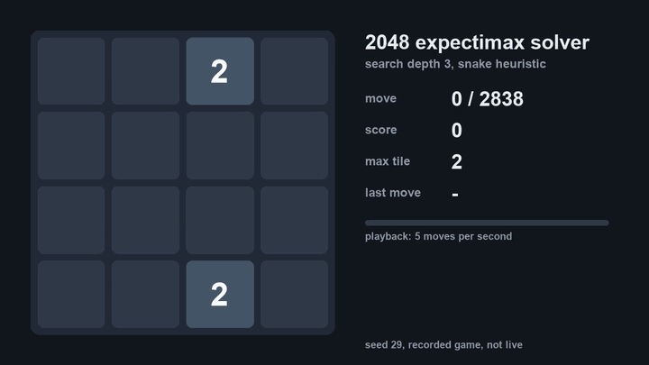
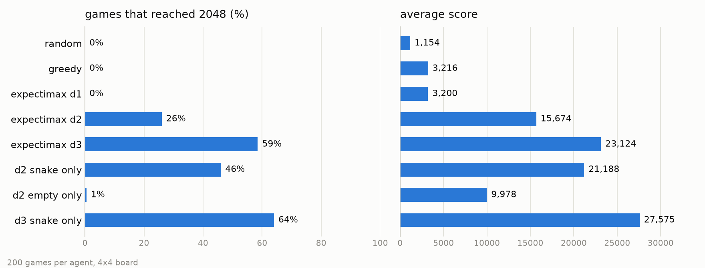
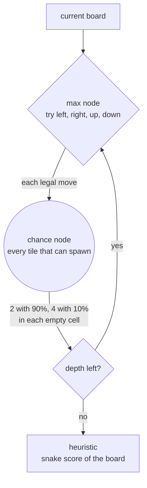

# 2048 expectimax solver

comp 560 final project.
a 2048 solver using expectimax search to evaluate decision making.

  

the clip is a recorded game at depth 3 that reaches 4096. it is one of the best games, not a typical one.
full videos are in [`demo/`](demo).

## contents

- [results](#results)
- [how it works](#how-it-works)
- [run it](#run-it)
- [layout](#layout)
- [ai use](#ai-use)

## results

200 games per agent on a 4x4 board.

| agent | what it does | avg score | reached 2048 | reached 4096 |
|---|---|---|---|---|
| random | any legal move | 1154 | 0% | 0% |
| greedy | best move by heuristic, no search | 3216 | 0% | 0% |
| expectimax d1 | depth 1, snake with empty cell bonus | 3200 | 0% | 0% |
| expectimax d2 | depth 2, snake with empty cell bonus | 15674 | 26% | 0% |
| expectimax d3 | depth 3, snake with empty cell bonus | 23124 | 59% | 2% |
| d2 snake only | depth 2, snake score | 21188 | 46% | 6% |
| d2 empty only | depth 2, empty cell count | 9978 | 1% | 0% |
| **d3 snake only** | **depth 3, snake score** | **27575** | **64%** | **10%** |

what we see:

- search depth matters most. 2048 is reached in 0% of games at depth 1, 26% at depth 2 and 59% at depth 3.
- depth 1 is almost the same as greedy. one level of chance does not change the choice much.
- the snake part of the heuristic does the work. the empty cell bonus we started with made the solver worse, so the solver now uses the snake score alone.
- deeper search is slow. one move takes about 5 ms at depth 2 and 190 ms at depth 3.

the full table and notes are in [`results/README.md`](results/README.md). every game is one row of [`results/games.csv`](results/games.csv).

## how it works

the player picks a move, then the game adds a tile at random.
expectimax follows the same two steps. a max node takes the best move, a chance node takes the weighted average over every tile that can spawn.

- **chance node**: a spawn is a 2 with 90% odds and a 4 with 10% odds, in any empty cell. with 6 empty cells that is 12 boards.
- **search**: `best_move(board, evaluate, depth)` returns left, right, up, down or None. depth counts player moves.
- **heuristic**: big tiles should follow a snake path that starts in the top left corner.

more detail is in [`solver/README.md`](solver/README.md).

## run it

python 3, run from the repo root. the game and the solver need no packages.

| command | what it does |
|---|---|
| `python3 main.py` | play by hand in the terminal |
| `python3 autoplay.py` | watch the solver play one game |
| `python3 autoplay.py --games 20 --depth 3` | play 20 games at depth 3 and print a summary |
| `python3 experiments.py --summary` | print the results table from the csv |
| `python3 experiments.py --games 200` | run the experiments, games already in the csv are skipped |
| `python3 results/plot.py` | draw the chart, needs matplotlib |
| `python3 record.py --depth 3 --seed 29` | record one game for the video |
| `python -m unittest` | run the tests |

## layout

| path | what is in it |
|---|---|
| `game/` | board, moves and game state |
| `solver/` | chance node, expectimax search, heuristic |
| `tests/` | unit tests |
| `experiments.py`, `results/` | baselines, ablations and the saved games |
| `autoplay.py` | lets the solver play by itself |
| `record.py`, `demo/` | recorded games and the video script |
| `main.py` | the game in the terminal |

## ai use

we used an ai assistant (claude) for the parts below.

- **experiment infrastructure**: the tooling around the experiments. running games in parallel, saving every game to a csv, resuming an interrupted run, and scaling the evaluation to 200 games per agent.
- **figures, video and readme**: the results chart, the demo videos and the layout of this readme.
- **testing and verification**: test scaffolding, debugging, and an end to end check of the code against an independent reference implementation.
- **proofreading**: spelling and wording of the written notes.

all numbers above come from `results/games.csv` and can be rebuilt with the commands in this readme.
